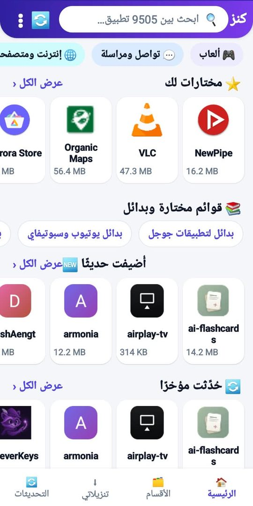
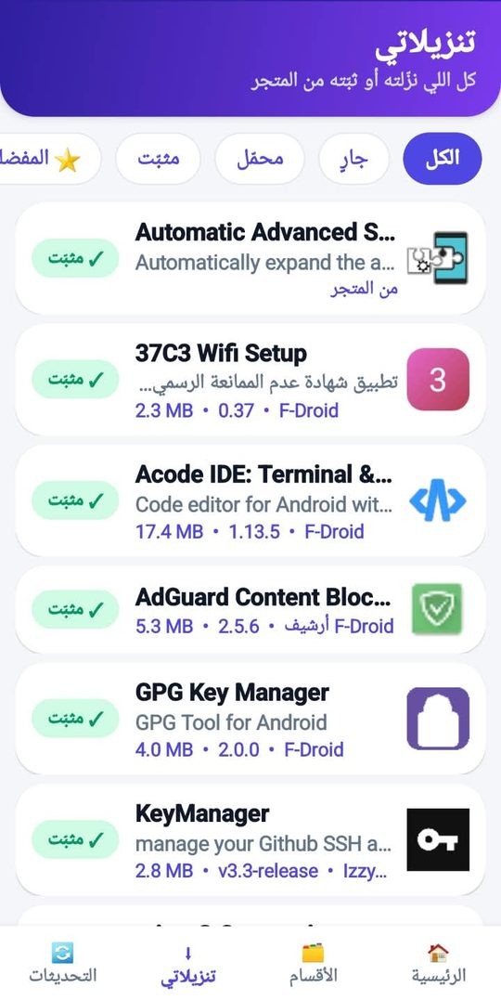

  
  <h1>Kanz · كنز</h1>
  
<strong>An open-source Android app store for discovering, exploring and installing free and open-source apps.</strong>

  

    
    
    
    
  

  

    <a href="https://github.com/ibra8y3-web/kanz-app/releases/latest/download/kanz.apk"><strong>Download Kanz APK</strong></a>
    · <a href="https://ibra8y3-web.github.io/kanz/">Browse the catalog</a>
    · <a href="https://github.com/ibra8y3-web/kanz">Catalog source</a>
  

Kanz brings open-source Android software into one searchable place. Browse apps by category, inspect their details and available releases, download them, and keep track of updates from a lightweight Android interface.

## Contents

- [Features](#features)
- [Screenshots](#screenshots)
- [Download and install](#download-and-install)
- [Build from source](#build-from-source)
- [Publishing a release](#publishing-a-release)
- [Project structure](#project-structure)
- [Security and app verification](#security-and-app-verification)
- [License](#license)
- [العربية](#العربية)

## Features

- **Discover and search:** browse the catalog, search by app name, and explore organized categories.
- **App details:** review app information, source projects, release versions and available downloads.
- **Download manager:** follow download progress and continue to Android's installation flow.
- **Update tracking:** see available updates for installed apps; scheduled checks can download updates over Wi-Fi and notify you.
- **Live catalog sync:** refresh the app catalog as new entries and releases are published.
- **Favorites and lists:** save apps, create and share curated lists, and open shared Kanz links.
- **Compare and revisit:** compare apps, view available screenshots and inspect older releases when listed.
- **Backup and restore:** export and import your installed-app list.
- **Your preferred interface:** Arabic, English and French translations, with light, dark and system-based appearance options.

Kanz uses community-maintained repositories and the companion Kanz catalog. Available sources include F-Droid, IzzyOnDroid, F-Droid Archive, Guardian Project, CalyxOS, microG, Molly, Bitwarden and KDE, alongside supported project discovery.

## Screenshots

<table>
  <tr>
    <td align="center"> <strong>Home</strong></td>
    <td align="center"> <strong>Categories</strong></td>
  </tr>
  <tr>
    <td align="center"> <strong>Catalog sync</strong></td>
    <td align="center"> <strong>Downloads</strong></td>
  </tr>
</table>

## Download and install

**Recommended: use the latest official GitHub release.**

1. Open the [latest Kanz release](https://github.com/ibra8y3-web/kanz-app/releases/latest) or [download kanz.apk directly](https://github.com/ibra8y3-web/kanz-app/releases/latest/download/kanz.apk).
2. Open the downloaded APK on your Android device.
3. When Android asks, allow installation for the browser or file manager you used to open the APK.
4. Review the Android installation prompt and complete the installation.

You can also visit the [Kanz catalog website](https://ibra8y3-web.github.io/kanz/).

**Requirements:** Android 7.0 (API 24) or later and an internet connection for catalog browsing, downloads and synchronization.

## Build from source

The current Android build is maintained in <code>android/</code>. The build uses a custom shell script rather than a Gradle wrapper.

### Toolchain

- JDK 17
- Android SDK platform 34
- Android SDK Build-Tools 34.0.0
- The local toolchain layout expected by <code>android/build.sh</code>:

~~~text
android/
├── jdk-17.0.21.1+2/
├── sdk/
│   ├── build-tools/34.0.0/
│   └── platforms/android-34/android.jar
└── build.sh
~~~

### Build

~~~bash
git clone https://github.com/ibra8y3-web/kanz-app.git
cd kanz-app/android

# Set the password for your signing keystore.
export KS_PASS="YOUR_KEYSTORE_PASSWORD"

bash build.sh
~~~

The script produces <code>android/almasdar-store.apk</code>.

**Signing key warning:** updates must be signed with the same keystore used for the installed app. Keep the original <code>android/ks.jks</code> and its password backed up securely. Do not publish either one. Creating a new keystore changes the signing identity and prevents the resulting APK from updating an installation signed with the previous key.

## Publishing a release

The release workflow is defined in [<code>.github/workflows/release.yml</code>](.github/workflows/release.yml). It runs when <code>release/kanz.apk</code> or <code>version.txt</code> changes on <code>main</code> or <code>master</code>, and can also be started manually.

For a new release:

1. Update the Android version name and version code in <code>android/app/AndroidManifest.xml</code>.
2. Set the matching version in <code>version.txt</code> (the first value is used as the release tag).
3. Build and sign the APK with the project's existing release keystore.
4. Replace <code>release/kanz.apk</code> with the new APK.
5. Commit and push the APK and version metadata.

GitHub Actions creates the corresponding <code>v&lt;version&gt;</code> release, or replaces the APK asset when that tag already exists. See the [release workflow](.github/workflows/release.yml) for the exact automation.

## Project structure

| Path | Purpose |
| --- | --- |
| <code>android/</code> | Current Android application source, manifest and build script |
| <code>release/kanz.apk</code> | APK artifact used by the release workflow |
| <code>version.txt</code> | Release version and Android version-code metadata |
| <code>docs/screenshots/</code> | Application screenshots used in this README |
| <code>crawler/</code> and <code>config.json</code> | Companion catalog discovery and configuration sources |
| <code>tests/</code> | Offline crawler test suite |

The catalog service and its published data are maintained separately in [ibra8y3-web/kanz](https://github.com/ibra8y3-web/kanz).

## Security and app verification

Kanz helps you discover open-source apps, but an automated catalog is not a substitute for a security audit. Check the upstream project, its license, release notes and permissions before installing software. Android remains responsible for the final installation confirmation.

To report a security concern, follow the instructions in [SECURITY.md](SECURITY.md). Contributions are welcome; see [CONTRIBUTING.md](CONTRIBUTING.md).

## License

Kanz is distributed under the [MIT License](LICENSE).

---

## العربية

**كنز (Kanz)** متجر تطبيقات أندرويد مفتوح المصدر، يساعدك تكتشف التطبيقات الحرة، تبحث عنها، تتصفحها حسب الأقسام، وتحمل إصداراتها من مكان واحد.

### أهم المميزات

- البحث عن التطبيقات واستكشافها من خلال أقسام منظمة.
- عرض تفاصيل التطبيقات ومشروعاتها ومصادرها والإصدارات المتاحة.
- تنزيل ملفات APK ومتابعة تقدم التحميل.
- متابعة تحديثات التطبيقات المثبتة واستقبال إشعارات بالتحديثات المتاحة.
- مزامنة الكتالوج للوصول إلى التطبيقات والإصدارات الجديدة.
- إضافة التطبيقات للمفضلة وإنشاء القوائم ومشاركتها.
- مقارنة التطبيقات واستعراض الصور والإصدارات الأقدم المتاحة.
- تصدير قائمة التطبيقات واستيرادها مرة أخرى.
- واجهة متعددة اللغات: العربية والإنجليزية والفرنسية، مع الوضع الفاتح والداكن.

### التحميل

حمّل أحدث إصدار من [صفحة الإصدارات الرسمية](https://github.com/ibra8y3-web/kanz-app/releases/latest)، أو [حمّل ملف APK مباشرة](https://github.com/ibra8y3-web/kanz-app/releases/latest/download/kanz.apk).

يمكنك أيضًا تصفح [كتالوج كنز](https://ibra8y3-web.github.io/kanz/).

**متطلبات التشغيل:** أندرويد 7.0 أو أحدث، واتصال بالإنترنت لمزامنة الكتالوج وتنزيل التطبيقات.

### البناء من المصدر

تعليمات البناء الحالية موجودة في قسم [Build from source](#build-from-source). يعتمد مسار البناء على JDK 17 وAndroid SDK 34 وملف البناء <code>android/build.sh</code>.

**تنبيه التوقيع:** احتفظ بمفتاح التوقيع الأصلي <code>android/ks.jks</code> وكلمة مروره. استخدام مفتاح جديد يمنع تثبيت التحديث فوق نسخة موقعة بالمفتاح القديم.

### المساهمة والترخيص

نرحب بالمساهمات والبلاغات عبر ملفات [CONTRIBUTING](CONTRIBUTING.md) و[SECURITY](SECURITY.md). المشروع متاح وفق رخصة [MIT](LICENSE).

