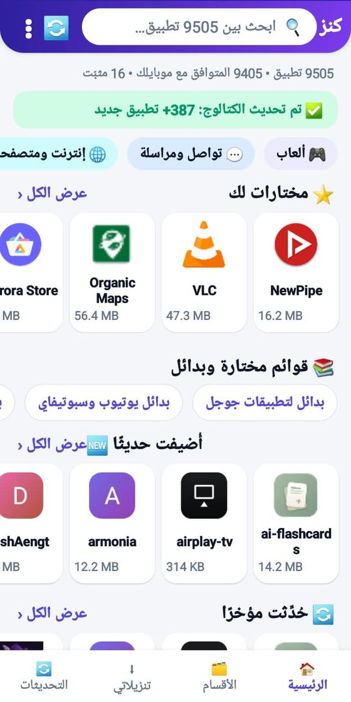
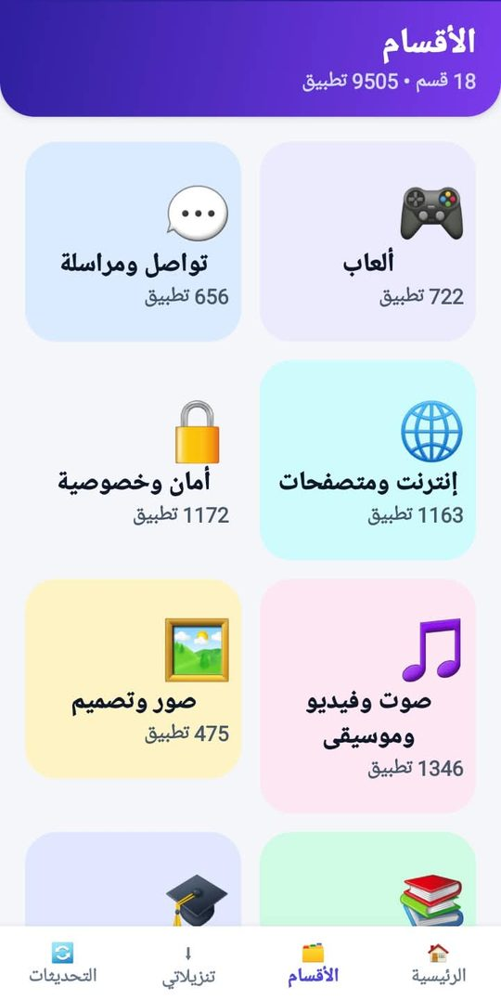
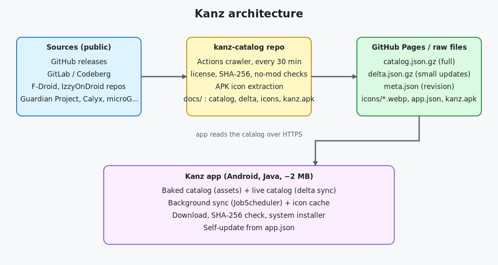

<div align="center">


# كنز | Kanz

**متجر تطبيقات أندرويد مفتوحة المصدر، خفيف وبالعربي**
**A small, Arabic-first open-source app store for Android**

[](#)
[](#)
[-orange)](#)
[](https://ibra8y3-web.github.io/kanz-catalog/)
[](LICENSE)

[**⬇ Download APK / تحميل التطبيق**](https://ibra8y3-web.github.io/kanz-catalog/kanz.apk) ·
[**🌐 Website / الموقع**](https://ibra8y3-web.github.io/kanz-catalog/) ·
[**Catalog repo / مستودع الكتالوج**](https://github.com/ibra8y3-web/kanz-catalog)

[العربية](#العربية) · [English](#english)

</div>

---

## العربية

**كنز** متجر تطبيقات أندرويد بيجمع تطبيقات **مفتوحة المصدر فقط** من مصادر عامة، ويتثبت بحجم حوالي 2 ميجا. معمول للموبايلات الضعيفة وللنت المحدود.

### المميزات
- **آلاف التطبيقات**: كتالوج مدمج جوه التطبيق (من F-Droid وIzzyOnDroid وغيرهم) يشتغل من غير نت، وكتالوج حي بيتحدث كل 30 دقيقة من GitHub وGitLab وCodeberg.
- **تحديث خفيف للنت**: التطبيق بيحمل التغييرات الصغيرة (delta) بدل الكتالوج كله، وبيزامن في الخلفية.
- **أمان**: كل ملف بيتحقق من بصمته SHA-256 قبل التثبيت. التثبيت بيتم عن طريق مثبّت النظام.
- **قواعد قبول صارمة** في الزاحف: ترخيص مفتوح معروف، Release حقيقي فيه APK، مش مؤرشف، ومفيش تطبيقات معدلة أو مكركة أو مدفوعة.
- **أيقونات** بتتجاب وتتخزن، وبتتستخرج من الـAPK لو المصدر مفيهوش أيقونة.
- **واجهة عربية** مع بحث وتصنيفات ومفضلة وقوائم.
- **تحديث ذاتي** للمتجر نفسه من ملف `app.json`.

### لقطات الشاشة
لقطات حقيقية من موبايل أندرويد: الرئيسية، الرئيسية بعد تحديث الكتالوج، الأقسام، وتنزيلاتي.

<p align="center">




</p>


### الهيكلة


### بناء من الكود
المطلوب جنب `build.sh`: مجلد JDK 17 اسمه `jdk-17.0.21.1+2` (أو عدّل المسارات في أول السكريبت)، ومجلد `sdk/` فيه `build-tools/34.0.0` و`platforms/android-34`.

```bash
export KANZ_KS=/path/to/your.jks      # اختياري، الافتراضي ks.jks
export KANZ_KS_PASS='your password'   # أو هيسألك عنه
bash build.sh
```

الناتج: `almasdar-store.apk`. لو ملف المفتاح مش موجود هيتعمل مفتاح جديد. استخدم نفس المفتاح في كل إصدار، وإلا النسخة الجديدة مش هتتثبت فوق القديمة. **متنشرش المفتاح ولا الباسورد أبدًا.**
ملحوظة: لو بنيت بمفتاحك أنت، التطبيق هيكون بتوقيع مختلف عن النسخة الرسمية ومش هيتحدث فوقها.

### المساهمة
أي اقتراح أو إصلاح مرحب بيه: افتح Issue أو Pull Request. ولو لقيت تطبيق مفتوح المصدر ناقص من الكتالوج، افتح Issue في [مستودع الكتالوج](https://github.com/ibra8y3-web/kanz-catalog).

---

## English

**Kanz** is an Android app store that lists **open-source apps only**, from public sources. The APK is about 2 MB, built for low-end phones and limited mobile data. The UI is Arabic.

### Features
- **Thousands of apps**: a baked-in catalog (F-Droid, IzzyOnDroid and other repos) that works offline, plus a live catalog refreshed every 30 minutes from GitHub, GitLab and Codeberg.
- **Data-friendly sync**: small delta updates instead of the whole catalog, with background sync.
- **Integrity**: every download is checked against its SHA-256 before install. Installing goes through the system installer.
- **Strict crawler rules**: known open license, a real release with an APK, not archived, no modded, cracked or paid builds.
- **Icons** are fetched and cached, and extracted from the APK when the source has none.
- **Arabic UI** with search, categories, favorites and lists.
- **Self-update** for the store itself via `app.json`.

### Screenshots
Real screenshots from an Android phone: home, home after a catalog sync, categories, and my downloads.

<p align="center">


</p>


### Architecture


### Build from source
Next to `build.sh` you need a JDK 17 folder named `jdk-17.0.21.1+2` (or edit the paths at the top of the script) and an `sdk/` folder with `build-tools/34.0.0` and `platforms/android-34`.

```bash
export KANZ_KS=/path/to/your.jks      # optional, default ks.jks
export KANZ_KS_PASS='your password'   # or you will be prompted
bash build.sh
```

Output: `almasdar-store.apk`. If the keystore does not exist a new one is created. Reuse the same keystore for every release, otherwise a new APK will not install over the old one. **Never commit a keystore or password.**
If you build with your own key, your APK has a different signature from the official one and will not update over it.

### Repository layout
| Path | What |
|---|---|
| `app/` | Android project: manifest, `res/`, `src/store/*.java`, `assets/` |
| `build.sh` | Build and sign script |
| `tools/` | Scripts that generated the baked catalog |
| `docs/` | README images |

### Permissions
Internet and network state, install and delete packages, query installed packages (to show installed and updatable apps), notifications, boot receiver (reschedule sync), battery-optimization exemption request (keeps background sync alive).

### Contributing
Issues and pull requests are welcome. To add a missing open-source app, open an issue in the [catalog repo](https://github.com/ibra8y3-web/kanz-catalog).

## License / الرخصة
MIT. See [LICENSE](LICENSE). الرخصة MIT، التفاصيل في ملف [LICENSE](LICENSE).
